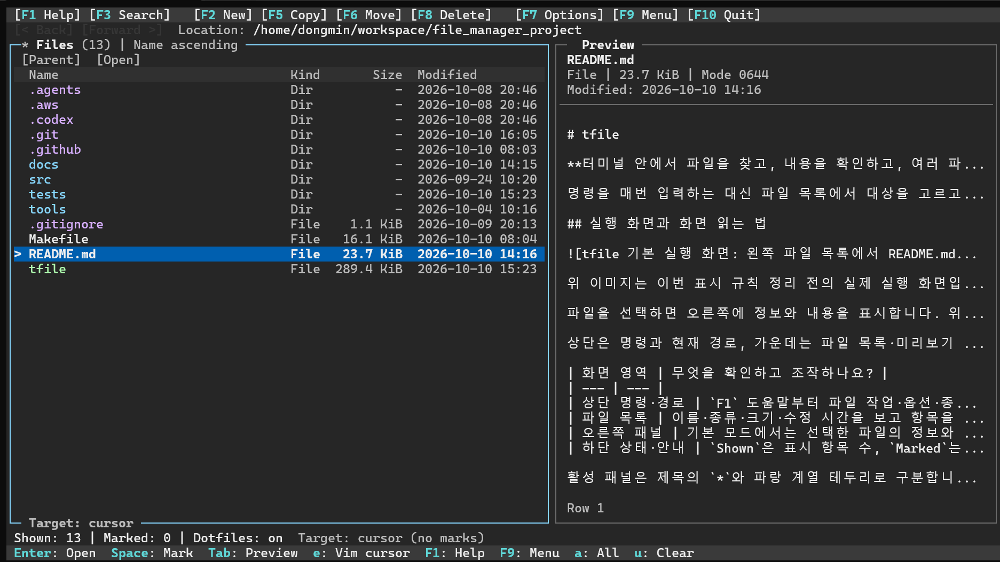

# tfile

**터미널에서 파일을 찾고, 내용을 확인하고, 정리하는 Linux/WSL 파일 관리자입니다.** C11과 ncursesw로 구현했습니다. 명령어가 낯설어도 목록과 메뉴에서 작업할 수 있도록 만들었습니다.



이 이미지는 이전 버전의 실제 실행 화면입니다. 현재의 `Target: cursor item`, 초점·하단 조작 안내와 차이가 있어 새 캡처가 필요합니다.

- 폴더 탐색·방문 기록, 목록 필터·파일 이름 검색.
- 텍스트 미리보기, 선택적 PNG/JPEG·PDF 첫 페이지 미리보기.
- 단일·다중 파일 복사·이동·휴지통·영구 삭제와 대상별 결과 확인.
- 목록+미리보기·이중 패널, Vim 편집·외부 뷰어·즐겨찾기.

경북대학교 컴퓨터학부 시스템프로그래밍 수업의 팀 프로젝트에서 직접 제안한 아이디어를 바탕으로, 이후 디자인 아이디어를 이어받아 코드를 새로 구현한 개인 후속 프로젝트입니다.

## 빠른 시작

필수 빌드 의존성은 **C11 컴파일러, make, ncursesw 개발 라이브러리**입니다. Ubuntu/WSL Ubuntu의 설치 예시이며 앱이 패키지를 자동 설치하지 않습니다.

```sh
sudo apt update
sudo apt install git build-essential libncurses-dev
git clone https://github.com/DongminKang0919/terminal-file-manager.git
cd terminal-file-manager
make
./tfile
```

일반 실행에는 대화형 터미널, 유효한 TERM/terminfo, 최소 **50열×9행**이 필요합니다. **100열×24행**과 UTF-8 로캘을 권장합니다.

```sh
./tfile /path/to/directory  # 생략하면 현재 디렉터리
./tfile -- -folder         # 하이픈으로 시작하는 경로
./tfile --help             # -h 옵션도 동일, TTY 없이 사용 가능
./tfile --version          # TTY 없이 사용 가능
```

도움말·버전 옵션은 단독으로 사용합니다. `--` 뒤에는 경로를 최대 하나 지정합니다. [전체 설치·명령행 안내](docs/INSTALL.md)에 오류·종료 코드 정책도 설명했습니다.

사용자 경로에 설치하려면:

```sh
make install PREFIX="$HOME/.local"
"$HOME/.local/bin/tfile"
```

sudo는 필요 없습니다. PATH에 설치 bin이 없다면 위 절대 경로로 실행하세요. 시스템 설치·DESTDIR·제거·선택 도구 상세는 [설치 안내](docs/INSTALL.md)에 있습니다.

**선택 도구:** Vim 편집은 `vim`, 외부 앱 열기는 `xdg-open`(Ubuntu: xdg-utils), 이미지 변환은 ImageMagick, PDF는 Poppler입니다. 없어도 탐색·텍스트 미리보기·기본 파일 작업은 가능합니다.

## 처음 사용하는 분께

아래 예제는 임시 연습 폴더만 만듭니다. 저장소에서 실행하며 설치했다면 `./tfile` 대신 설치 파일 경로를 사용하세요.

```sh
practice_dir=$(mktemp -d /tmp/tfile-practice.XXXXXX)
mkdir "$practice_dir/destination"
printf 'Hello, tfile!\n' > "$practice_dir/hello.txt"
./tfile "$practice_dir"
```

`hello.txt`를 선택해 미리보기를 읽고 F5를 누릅니다. To에 `destination`을 입력해 확인하고, Name은 그대로 둡니다. Target이 `destination/hello.txt`인지 확인한 뒤 **Copy 1 item**으로 실행합니다. `!`로 결과를 확인하고 q/F10으로 종료합니다. 연습 파일은 종료 후에도 /tmp에 남습니다.

## 기본 사용법

| 키 | 파일 목록에서의 동작 |
| --- | --- |
| ↑/↓, Enter, Backspace | 선택, 폴더 열기, 상위 폴더 이동 |
| Space | 작업 대상 마킹 전환 |
| F2, F5/F6 | 생성, 복사/이동 |
| t, F8/Delete | 휴지통 이동, 영구 삭제 확인 |
| Tab | 조작 가능한 미리보기·반대편 목록으로 초점 이동 |
| !, F1, F9 | 최근 결과, 도움말, 전체 메뉴 |
| q/F10 | 메인 화면 종료 |

`>`는 커서, 항목의 `*`는 마킹한 작업 대상입니다. 마킹이 하나라도 있으면 활성 패널의 마킹이 커서보다 우선합니다. 하단 Target을 확인하세요. `e`/Vim은 예외로 커서의 텍스트 파일 하나를 편집합니다. 자세한 키·마우스·폼 조작은 [사용자 안내](docs/USER_GUIDE.md)에 있습니다.

## 미리보기와 제한

PNG/JPEG 이미지는 **Sixel 지원 터미널 + ImageMagick의 magick/convert와 PNG/JPEG/SIXEL coder**가 필요합니다. PDF는 Poppler의 pdftoppm으로 **첫 페이지**를 이미지로 변환하며, 이미지 사용 불가 시 pdftotext로 첫 페이지 텍스트를 시도합니다. 모든 변환 실패가 텍스트로 대체되지는 않습니다.

표시가 안 되면 F7 → Image display setup에서 상태를 확인하세요. PDF 페이지 이동·확대/축소·OCR와 tmux/screen 그래픽 passthrough는 제공하지 않습니다. 문서 전체는 F9의 Open externally로 열 수 있습니다. [미디어 상세 안내](docs/USER_GUIDE.md#선택적-이미지pdf-미리보기-1단계)

## 파일 작업 주의사항

- **휴지통과 영구 삭제:** t는 휴지통 이동, F8/Delete는 복원할 수 없는 영구 삭제입니다. 둘 다 Cancel이 기본입니다. 휴지통 실패를 영구 삭제로 대체하지 않으며 앱 내 복원은 없습니다. 휴지통은 지원하는 로컬 POSIX 파일시스템에서 사용하며 원격·DrvFS 등은 거부합니다.
- **덮어쓰기·이동:** 기존 파일 덮어쓰기·폴더 병합·자동 이름 변경·자기 내부 전송은 지원하지 않습니다. 이동은 같은 파일시스템에서만 가능하며 교차 파일시스템 이동을 복사 후 삭제로 대체하지 않습니다.
- **취소·부분 완료:** 완료한 변경을 되돌리지 않습니다. 취소는 현재 파일시스템 호출 뒤 안전한 지점에서 처리되며 불완전한 복사·잔여 파일이 남을 수 있습니다. 자동 정리·재시도는 없습니다.
- **결과 불명확:** `!`에서 성공·건너뜀·실패·취소·미실행과 별도 목록 갱신 오류를 확인하세요. 결과가 불명확하면 원본·목적지 상태를 직접 확인한 뒤 재시도 여부를 결정합니다.

[파일 작업과 안전 정책](docs/USER_GUIDE.md#다중-선택과-파일-작업) · [상세 동작·구현](docs/REFERENCE.md)

## 구조와 검증

UI → core → platform으로 입력·표시와 파일 작업 정책, 운영체제 접근을 분리했습니다. 부분 완료를 자동 롤백하지 않고 대상별 결과를 보존합니다.

개발 검사에는 Python 3가 추가로 필요하며 저장소 루트에서 실행합니다.

```sh
make -j2 check       # 전체 회귀·PTY·계층·문서 검사
make check-cli      # 명령행 출력·환경·실제 -- 경로 검사
make check-install  # Git 없는 소스 빌드·버전 재빌드·설치·제거
make check-docs      # 문서 링크·앵커 검사
```

버전 원본은 [src/version.h](src/version.h) 하나이며 현재 개발 버전입니다. 갱신 후 make로 재빌드합니다. Git 메타데이터나 빌드 시각은 버전에 넣지 않습니다. [CLI·문서 정비 검증](docs/CLI_README_VALIDATION_2026-10-16.md)

### 검증 범위

[Linux CI](.github/workflows/linux.yml)는 GCC/Clang·회귀·sanitizer를 실행합니다. 구성과 실제 실행 결과는 구분합니다. 자동 PTY 통과는 실제 Sixel 픽셀·잔상·폰트 확인을 뜻하지 않습니다. 새 OS·모든 터미널·최신 WSL 전체를 검증했다고 주장하지 않습니다.

과거 WSL 수동 sanitizer 결과는 전달받은 산출물 범위입니다. 정확한 커밋·환경이 없는 결과를 현재 HEAD의 검증으로 소급하지 않습니다. [수동 결과와 한계](docs/MEDIA_PREVIEW_VALIDATION.md#수정-후-사용자-wsl-터미널의-수동-sanitizer-결과-검토)

## 상세 문서

[설치·제거](docs/INSTALL.md) · [사용자 안내](docs/USER_GUIDE.md) · [상세 정책](docs/REFERENCE.md) · [검증 기록 모음](docs/README.md)

## 라이선스

저장소에 LICENSE 파일이 없어 명시된 배포·재사용 라이선스가 없습니다.
