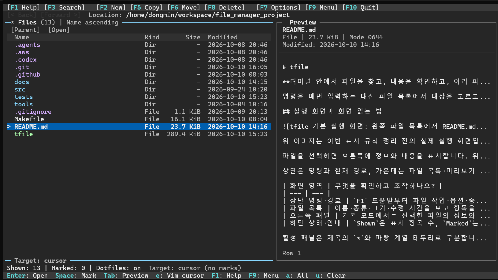

# tfile

**Linux와 WSL에서 쓰는 터미널 파일 관리자입니다.** 파일을 찾고, 내용을 미리 보고, 복사하거나 옮기는 작업을 한 화면에서 할 수 있습니다. C11과 ncursesw로 구현했으며 키보드와 마우스를 지원합니다.



_이전 버전의 실행 화면입니다. 현재 버전에서는 작업 대상과 패널 초점을 화면 하단에서 확인할 수 있습니다._

## 할 수 있는 일

| 작업 | 기능 |
| --- | --- |
| 파일 찾기 | 폴더 탐색, 방문 기록, 즐겨찾기, 목록 필터, 하위 폴더까지 파일 이름 검색 |
| 내용 확인 | 텍스트 미리보기, 환경에 따라 PNG/JPEG와 PDF 첫 페이지 미리보기 |
| 파일 정리 | 파일·폴더 생성, 이름 변경, 단일·다중 복사·이동·휴지통 이동·영구 삭제, 대상별 작업 결과 확인 |
| 화면과 외부 도구 | 목록과 미리보기 또는 두 파일 목록을 나란히 표시, Vim 편집, 외부 앱으로 열기 |

## 빠른 시작

### 필요한 환경

| 용도 | 요건 |
| --- | --- |
| 소스 빌드 | C11 컴파일러, make, ncursesw 개발 라이브러리. 저장소 복제에는 Git이 필요합니다. |
| 실행 | Linux 또는 WSL, 대화형 터미널, 유효한 `TERM`과 terminfo, 최소 50열×9행. 100열×24행과 UTF-8 로캘을 권장합니다. |
| 선택 기능 | 편집에는 Vim, 외부 앱으로 열기에는 `xdg-open`, 이미지에는 Sixel 지원 터미널과 ImageMagick, PDF에는 Poppler 도구가 필요합니다. |
| 개발 검사 | Python 3 |

### Ubuntu와 WSL Ubuntu에서 소스 빌드

```sh
sudo apt update
sudo apt install git build-essential libncurses-dev
git clone https://github.com/DongminKang0919/terminal-file-manager.git
cd terminal-file-manager
make
./tfile
```

`./tfile`은 현재 폴더에서 시작합니다. `./tfile /path/to/directory`로 시작 위치를 지정하고, `./tfile -- -folder`처럼 하이픈으로 시작하는 폴더를 열 수 있습니다. `./tfile --help`(`-h`)와 `./tfile --version`은 대화형 터미널 없이도 실행할 수 있습니다.

빌드한 프로그램을 사용자 경로에 설치하려면 저장소 루트에서 아래 명령을 실행하세요. 이 설치 단계에는 sudo가 필요 없습니다.

```sh
make install PREFIX="$HOME/.local"
"$HOME/.local/bin/tfile"
```

`$HOME/.local/bin`이 PATH에 있으면 `tfile`로 실행할 수 있습니다. 런타임 라이브러리, 선택 도구, 시스템 설치와 제거 방법은 설치 안내에 있습니다. [설치·제거 안내](docs/INSTALL.md)

## 기본 조작

| 키 | 동작 |
| --- | --- |
| ↑/↓, Enter, Backspace | 항목 선택, 폴더 열기, 상위 폴더로 이동 |
| F3, Ctrl+F | 하위 폴더까지 파일 이름 검색, 현재 목록에서 찾기 |
| Space | 작업 대상 마킹 전환 |
| F2, F5, F6 | 생성, 복사, 이동 |
| t, F8 또는 Delete | 휴지통 이동, 영구 삭제 확인 |
| Tab | 조작 가능한 미리보기 또는 반대편 목록으로 초점 이동 |
| !, F1, F9 | 최근 작업 결과, 도움말, 전체 메뉴 |
| q 또는 F10 | 메인 화면에서 종료 |

`>`는 커서, `*`는 마킹한 항목입니다. 활성 패널에 마킹이 있으면 파일 작업은 그 항목들을 대상으로 합니다. 실행 전에 하단의 Target 표시를 확인하세요. `e`로 Vim을 열면 커서가 가리키는 텍스트 파일 하나를 편집합니다. [전체 조작 안내](docs/USER_GUIDE.md)

<details>
<summary>임시 폴더에서 복사 연습하기</summary>

저장소 루트에서 실행합니다. 연습 파일은 종료 후에도 임시 폴더에 남습니다.

```sh
practice_dir=$(mktemp -d /tmp/tfile-practice.XXXXXX)
mkdir "$practice_dir/destination"
printf 'Hello, tfile!\n' > "$practice_dir/hello.txt"
./tfile "$practice_dir"
```

1. `hello.txt`를 선택하고 F5를 누릅니다.
2. To에 `destination`을 입력하고 Name은 그대로 둡니다.
3. Target이 `destination/hello.txt`인지 확인하고 **Copy 1 item**을 실행합니다.
4. `!`로 결과를 확인하고 q 또는 F10으로 종료합니다.

</details>

## 파일 작업과 미리보기의 제한

- **삭제** · `t`는 지원하는 로컬 파일시스템의 휴지통으로 보냅니다. 앱 내 복원은 제공하지 않습니다. F8/Delete는 영구 삭제이므로 확인창에서 대상을 확인하세요. 두 동작 모두 기본 선택은 Cancel입니다.
- **복사·이동** · 기존 파일 덮어쓰기, 폴더 병합, 충돌 시 자동 이름 변경, 폴더를 자기 하위로 복사·이동하는 작업은 지원하지 않습니다. 이동은 같은 파일시스템에서만 가능합니다.
- **취소·실패** · 완료된 변경과 불완전한 복사본이 남을 수 있습니다. `!`에서 대상별 결과와 목록 갱신 오류를 확인할 수 있습니다. 자동 정리나 재시도는 제공하지 않습니다. [파일 작업 상세](docs/USER_GUIDE.md#다중-선택과-파일-작업)
- **미디어** · 이미지 표시는 터미널의 Sixel 지원과 ImageMagick의 형식 지원에 따라 달라집니다. PDF 미리보기는 첫 페이지를 대상으로 합니다. 이미지 표시를 사용할 수 없는 경우에는 조건에 따라 첫 페이지 텍스트 추출을 시도합니다. PDF 페이지 이동·확대/축소·OCR과 tmux/screen 그래픽 passthrough는 지원하지 않습니다. 표시 상태는 F7 → Image display setup에서 확인하고, 문서 전체는 F9 → Open externally로 열 수 있습니다. [미디어 설정과 제한](docs/USER_GUIDE.md#선택적-이미지pdf-미리보기-1단계)

## 코드 구조

입력과 표시를 맡는 UI가 core에 작업을 요청하고, core는 platform의 운영체제 기능을 사용합니다.

| 경로 | 역할 |
| --- | --- |
| [src/ui/](src/ui/) | ncurses 화면, 키보드·마우스 입력, 패널과 작업 대화상자 |
| [src/core/](src/core/) | 탐색·검색·선택, 미리보기, 파일 작업 정책과 작업 상태 |
| [src/platform/](src/platform/) | POSIX 파일시스템 접근, 외부 프로그램 및 미디어 변환 실행 |
| [src/model.h](src/model.h) | 파일 항목과 작업 결과 등 공용 데이터 타입 |
| [tests/](tests/) | C 단위·회귀 검사와 Python 기반 가상 터미널(PTY) 검사 |
| [docs/](docs/) | 사용자 안내, 구현 정책, 기능 계획과 검증 기록 |

### 개발 검사

```sh
make -j2 check       # 전체 회귀·PTY·계층·문서 검사
make check-cli      # 명령행 옵션과 시작 경로 검사
make check-install  # 깨끗한 소스에서 빌드·설치·제거 검사
make check-docs     # 문서 링크와 앵커 검사
```

### 검증 범위

버전은 [src/version.h](src/version.h)에서 관리합니다. [Linux CI](.github/workflows/linux.yml)는 GCC·Clang 검사와 sanitizer를 실행하도록 구성되어 있습니다. PTY 검사는 가상 터미널의 입력과 출력을 확인합니다. 실제 터미널의 Sixel 표시와 화면 지우기 검증 범위는 [미디어 검증 기록](docs/MEDIA_PREVIEW_VALIDATION.md)에서 확인할 수 있습니다.

## 프로젝트 배경과 문서

경북대학교 컴퓨터학부 시스템프로그래밍 수업의 팀 프로젝트에서 직접 제안한 디자인 아이디어를 이어받아, 코드를 새로 구현한 개인 후속 프로젝트입니다.

[설치 안내](docs/INSTALL.md) · [사용자 안내](docs/USER_GUIDE.md) · [동작·구현 상세](docs/REFERENCE.md) · [기능 체크리스트](docs/FEATURE_CHECKLIST.md) · [배포 계획](docs/RELEASE_PLAN.md) · [문서 목차](docs/README.md)

## 라이선스

저장소의 배포·재사용 라이선스는 검토 중입니다. [라이선스 검토 항목](docs/RELEASE_PLAN.md#라이선스-결정)
