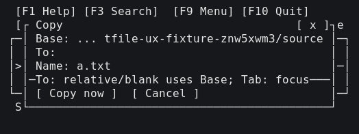
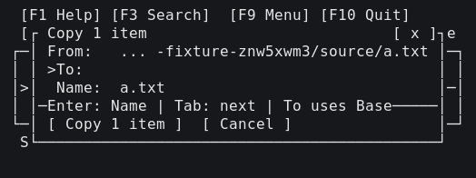
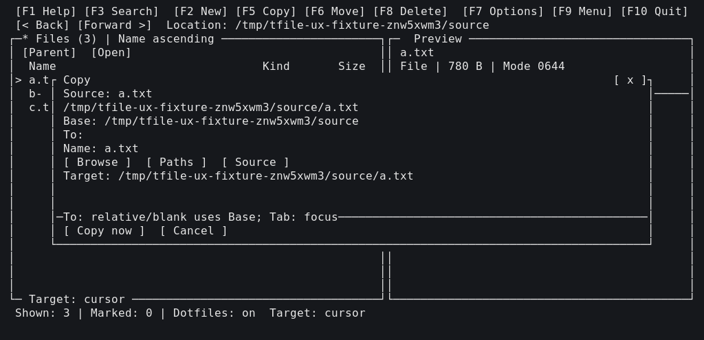
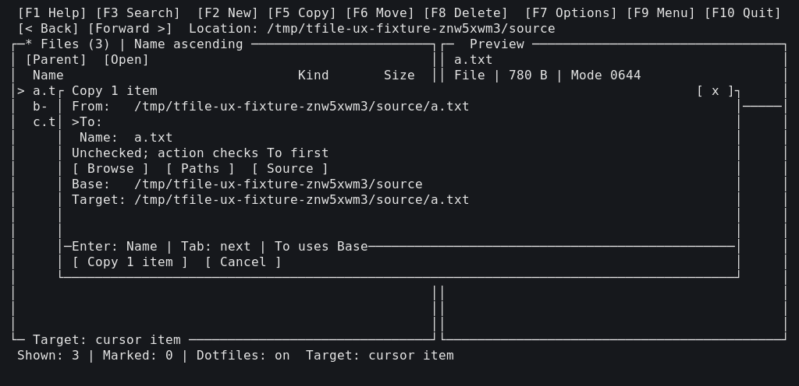

# 작업 대상 UI 전후 PTY 셀 기록 (2026-10-16)

기준 bcc9d54와 수정본을 같은 fixture·mtime·HOME/XDG·터미널 크기로 실행했다. 76개씩의 전체 JSON은 `/tmp/tfile-ux-before-records/screens.json`, `/tmp/tfile-ux-after-records/screens.json`에 있다. 아래 28쌍은 해당 데이터에서 고른 원본 셀 기록이다. 경로를 치환하지 않아 원본 셀 폭과 테두리를 유지한다. Markdown은 행 끝의 공백만 제거하며 JSON과 이미지는 전체 폭을 보존한다. fixture 경로는 두 실행에서 동일하다. 색상·굵기·반전·픽셀·깜빡임은 표현하지 않는다.

50열 단일 폼 (전 / 후):





100열 단일 폼 (전 / 후):





이미지는 위 셀 기록의 단색 재구성이며 실제 그래픽 터미널 스크린샷이 아니다. 한글의 정확한 셀 내용은 아래 텍스트로 확인한다.

## 50열 mode=0 two-marks-cursor-elsewhere

Before

```text
 [F1 Help] [F3 Search]  [F9 Menu] [F10 Quit]
 [<] [>]  Location: ... x-fixture-znw5xwm3/source
┌─* Files (3) | Name ascending ──────────────────┐
│ [Parent]  [Open]                               │
│ *b-한글.txt                   File      780 B  │
│> c.txt                        File      780 B  │
└─ Targets: 2 marked 2-3/3 ──────────────────────┘
 Shown: 3 Marked: 2  Targets: 2 marked
 Enter: Open  Space: Mark  e: Vim cursor
```

After

```text
 [F1 Help] [F3 Search]  [F9 Menu] [F10 Quit]
 [<] [>]  Location: ... x-fixture-znw5xwm3/source
┌─* Files (3) | Name ascending ──────────────────┐
│ [Parent]  [Open]                               │
│ *b-한글.txt                   File      780 B  │
│> c.txt                        File      780 B  │
└─ Target: 2 marked items 2-3/3 ─────────────────┘
 Shown: 3 Marked: 2  Target: 2 marked items
 Enter: Open  Space: Mark  F5: Copy  F9: Menu
```

## 50열 mode=1 two-marks-cursor-elsewhere

Before

```text
 [F1 Help] [F3 Search]  [F9 Menu] [F10 Quit]
 [<] [>]  Location: ... x-fixture-znw5xwm3/source
┌─* Files (3) Name+ ─────────┐┌─  Preview ───────┐
│ [Parent]  [Open]           ││c.txt             │
│ *b-한글.txt          File  ││──────────────────│
│> c.txt               File  ││Preview body      │
└─ Targets: 2 marked 2-3/3 ──┘└──────────────────┘
 Shown: 3 Marked: 2  Targets: 2 marked
 Enter: Open  Space: Mark  Tab: Preview
```

After

```text
 [F1 Help] [F3 Search]  [F9 Menu] [F10 Quit]
 [<] [>]  Location: ... x-fixture-znw5xwm3/source
┌─* Files (3) Name+ ─────────┐┌─  Preview ───────┐
│ [Parent]  [Open]           ││c.txt             │
│ *b-한글.txt          File  ││──────────────────│
│> c.txt               File  ││Preview body      │
└─ Target: 2 marked 2-3/3────┘└──────────────────┘
 Shown: 3 Marked: 2  Target: 2 marked items
 Enter: Open  Space: Mark  F5: Copy  Tab: Preview
```

## 50열 mode=2 two-marks-cursor-elsewhere

Before

```text
 [F1 Help] [F3 Search]  [F9 Menu] [F10 Quit]
 [<] [>]  /tmp/tfile-ux-fixture-znw5xwm3/source
┌─* Left Name+ Marked:2 Dotfiles:on ─────────────┐
│ [Parent]  [Open]                               │
│ *b-한글.txt                   File      780 B  │
│> c.txt                        File      780 B  │
└─ Targets: 2 marked 2-3/3 ──────────────────────┘
 Left* Shown: 3 Marked: 2  Targets: 2 marked
 Enter: Open  Space: Mark  Tab: Other
```

After

```text
 [F1 Help] [F3 Search]  [F9 Menu] [F10 Quit]
 [<] [>]  /tmp/tfile-ux-fixture-znw5xwm3/source
┌─* Left Name+ Marked:2 Dotfiles:on ─────────────┐
│ [Parent]  [Open]                               │
│ *b-한글.txt                   File      780 B  │
│> c.txt                        File      780 B  │
└─ Target: 2 marked items 2-3/3 ─────────────────┘
 Left* Shown: 3 Marked: 2  Target: 2 marked items
 Enter: Open  Space: Mark  F5: Copy  Tab: Other
```

## 100열 mode=0 two-marks-cursor-elsewhere

Before

```text
 [F1 Help] [F3 Search]  [F2 New] [F5 Copy] [F6 Move] [F8 Delete]  [F7 Options] [F9 Menu] [F10 Quit]
 [< Back] [Forward >]  Location: /tmp/tfile-ux-fixture-znw5xwm3/source
┌─* Files (3) | Name ascending ────────────────────────────────────────────────────────────────────┐
│ [Parent]  [Open]                                                                                 │
│  Name                                                          Kind       Size  Modified         │
│ *a.txt                                                         File      780 B  2023-11-15 07:13 │
│ *b-한글.txt                                                    File      780 B  2023-11-15 07:13 │
│> c.txt                                                         File      780 B  2023-11-15 07:13 │
│                                                                                                  │
│                                                                                                  │
│                                                                                                  │
│                                                                                                  │
│                                                                                                  │
│                                                                                                  │
│                                                                                                  │
│                                                                                                  │
│                                                                                                  │
│                                                                                                  │
│                                                                                                  │
│                                                                                                  │
│                                                                                                  │
└─ Targets: 2 marked ──────────────────────────────────────────────────────────────────────────────┘
 Shown: 3 | Marked: 2 | Dotfiles: on  Targets: 2 marked
 Enter: Open  Space: Mark  e: Vim cursor  F1: Help  F9: Menu  a: All  u: Clear
```

After

```text
 [F1 Help] [F3 Search]  [F2 New] [F5 Copy] [F6 Move] [F8 Delete]  [F7 Options] [F9 Menu] [F10 Quit]
 [< Back] [Forward >]  Location: /tmp/tfile-ux-fixture-znw5xwm3/source
┌─* Files (3) | Name ascending ────────────────────────────────────────────────────────────────────┐
│ [Parent]  [Open]                                                                                 │
│  Name                                                          Kind       Size  Modified         │
│ *a.txt                                                         File      780 B  2023-11-15 07:13 │
│ *b-한글.txt                                                    File      780 B  2023-11-15 07:13 │
│> c.txt                                                         File      780 B  2023-11-15 07:13 │
│                                                                                                  │
│                                                                                                  │
│                                                                                                  │
│                                                                                                  │
│                                                                                                  │
│                                                                                                  │
│                                                                                                  │
│                                                                                                  │
│                                                                                                  │
│                                                                                                  │
│                                                                                                  │
│                                                                                                  │
│                                                                                                  │
└─ Target: 2 marked items ─────────────────────────────────────────────────────────────────────────┘
 Shown: 3 | Marked: 2 | Dotfiles: on  Target: 2 marked items
 Enter: Open  Space: Mark  F5: Copy  F9: Menu  e: Vim cursor  F1: Help  u: Clear marks
```

## 100열 mode=1 two-marks-cursor-elsewhere

Before

```text
 [F1 Help] [F3 Search]  [F2 New] [F5 Copy] [F6 Move] [F8 Delete]  [F7 Options] [F9 Menu] [F10 Quit]
 [< Back] [Forward >]  Location: /tmp/tfile-ux-fixture-znw5xwm3/source
┌─* Files (3) | Name ascending ───────────────────────┐┌─  Preview ────────────────────────────────┐
│ [Parent]  [Open]                                    ││ c.txt                                     │
│  Name                              Kind       Size  ││ File | 780 B | Mode 0644                  │
│ *a.txt                             File      780 B  ││ Modified: 2023-11-15 07:13                │
│ *b-한글.txt                        File      780 B  ││───────────────────────────────────────────│
│> c.txt                             File      780 B  ││                                           │
│                                                     ││ Preview body                              │
│                                                     ││ Preview body                              │
│                                                     ││ Preview body                              │
│                                                     ││ Preview body                              │
│                                                     ││ Preview body                              │
│                                                     ││ Preview body                              │
│                                                     ││ Preview body                              │
│                                                     ││ Preview body                              │
│                                                     ││ Preview body                              │
│                                                     ││ Preview body                              │
│                                                     ││ Preview body                              │
│                                                     ││ Preview body                              │
│                                                     ││ Row 1                                     │
└─ Targets: 2 marked ─────────────────────────────────┘└───────────────────────────────────────────┘
 Shown: 3 | Marked: 2 | Dotfiles: on  Targets: 2 marked
 Enter: Open  Space: Mark  Tab: Preview  e: Vim cursor  F1: Help  F9: Menu  a: All  u: Clear
```

After

```text
 [F1 Help] [F3 Search]  [F2 New] [F5 Copy] [F6 Move] [F8 Delete]  [F7 Options] [F9 Menu] [F10 Quit]
 [< Back] [Forward >]  Location: /tmp/tfile-ux-fixture-znw5xwm3/source
┌─* Files (3) | Name ascending ───────────────────────┐┌─  Preview ────────────────────────────────┐
│ [Parent]  [Open]                                    ││ c.txt                                     │
│  Name                              Kind       Size  ││ File | 780 B | Mode 0644                  │
│ *a.txt                             File      780 B  ││ Modified: 2023-11-15 07:13                │
│ *b-한글.txt                        File      780 B  ││───────────────────────────────────────────│
│> c.txt                             File      780 B  ││                                           │
│                                                     ││ Preview body                              │
│                                                     ││ Preview body                              │
│                                                     ││ Preview body                              │
│                                                     ││ Preview body                              │
│                                                     ││ Preview body                              │
│                                                     ││ Preview body                              │
│                                                     ││ Preview body                              │
│                                                     ││ Preview body                              │
│                                                     ││ Preview body                              │
│                                                     ││ Preview body                              │
│                                                     ││ Preview body                              │
│                                                     ││ Preview body                              │
│                                                     ││ Row 1                                     │
└─ Target: 2 marked items ────────────────────────────┘└───────────────────────────────────────────┘
 Shown: 3 | Marked: 2 | Dotfiles: on  Target: 2 marked items
 Enter: Open  Space: Mark  F5: Copy  Tab: Preview  F9: Menu  e: Vim cursor  F1: Help
```

## 100열 mode=2 two-marks-cursor-elsewhere

Before

```text
 [F1 Help] [F3 Search]  [F2 New] [F5 Copy] [F6 Move] [F8 Delete]  [F7 Options] [F9 Menu] [F10 Quit]
 [<] [>]  /tmp/tfile-ux-fixture-znw5xwm3/source    [<] [>]  /tmp/tfile-ux-fixture-znw5xwm3/source
┌─* Left Name+ Marked:2 Dotfiles:on ─────────────┐┌─  Right Name+ Marked:0 Dotfiles:on ────────────┐
│ [Parent]  [Open]                               ││ [Parent]  [Open]                               │
│  Name                         Kind       Size  ││  Name                         Kind       Size  │
│ *a.txt                        File      780 B  ││: a.txt                        File      780 B  │
│ *b-한글.txt                   File      780 B  ││  b-한글.txt                   File      780 B  │
│> c.txt                        File      780 B  ││  c.txt                        File      780 B  │
│                                                ││                                                │
│                                                ││                                                │
│                                                ││                                                │
│                                                ││                                                │
│                                                ││                                                │
│                                                ││                                                │
│                                                ││                                                │
│                                                ││                                                │
│                                                ││                                                │
│                                                ││                                                │
│                                                ││                                                │
│                                                ││                                                │
│                                                ││                                                │
└─ Targets: 2 marked ────────────────────────────┘└────────────────────────────────────────────────┘
 Left* Shown: 3 | Marked: 2 | Dotfiles: on  Targets: 2 marked
 Enter: Open  Space: Mark  Tab: Other  e: Vim cursor  F1: Help  F9: Menu  a: All  u: Clear
```

After

```text
 [F1 Help] [F3 Search]  [F2 New] [F5 Copy] [F6 Move] [F8 Delete]  [F7 Options] [F9 Menu] [F10 Quit]
 [<] [>]  /tmp/tfile-ux-fixture-znw5xwm3/source    [<] [>]  /tmp/tfile-ux-fixture-znw5xwm3/source
┌─* Left Name+ Marked:2 Dotfiles:on ─────────────┐┌─  Right Name+ Marked:0 Dotfiles:on ────────────┐
│ [Parent]  [Open]                               ││ [Parent]  [Open]                               │
│  Name                         Kind       Size  ││  Name                         Kind       Size  │
│ *a.txt                        File      780 B  ││: a.txt                        File      780 B  │
│ *b-한글.txt                   File      780 B  ││  b-한글.txt                   File      780 B  │
│> c.txt                        File      780 B  ││  c.txt                        File      780 B  │
│                                                ││                                                │
│                                                ││                                                │
│                                                ││                                                │
│                                                ││                                                │
│                                                ││                                                │
│                                                ││                                                │
│                                                ││                                                │
│                                                ││                                                │
│                                                ││                                                │
│                                                ││                                                │
│                                                ││                                                │
│                                                ││                                                │
│                                                ││                                                │
└─ Target: 2 marked items ───────────────────────┘└────────────────────────────────────────────────┘
 Left* Shown: 3 | Marked: 2 | Dotfiles: on  Target: 2 marked items
 Enter: Open  Space: Mark  F5: Copy  Tab: Other  F9: Menu  e: Vim cursor  F1: Help  u: Clear marks
```

## 50열 mode=1 cursor

Before

```text
 [F1 Help] [F3 Search]  [F9 Menu] [F10 Quit]
 [<] [>]  Location: ... x-fixture-znw5xwm3/source
┌─* Files (3) Name+ ─────────┐┌─  Preview ───────┐
│ [Parent]  [Open]           ││a.txt             │
│> a.txt               File  ││──────────────────│
│  b-한글.txt          File  ││Preview body      │
└─ Target: cursor 1-2/3 ─────┘└──────────────────┘
 Shown: 3 | Marked: 0 | Dotfiles: on
 Enter: Open  Space: Mark  Tab: Preview
```

After

```text
 [F1 Help] [F3 Search]  [F9 Menu] [F10 Quit]
 [<] [>]  Location: ... x-fixture-znw5xwm3/source
┌─* Files (3) Name+ ─────────┐┌─  Preview ───────┐
│ [Parent]  [Open]           ││a.txt             │
│> a.txt               File  ││──────────────────│
│  b-한글.txt          File  ││Preview body      │
└─ Target: cursor 1-2/3──────┘└──────────────────┘
 Shown: 3 | Marked: 0 | Dotfiles: on
 Enter: Open  Space: Mark  F5: Copy  Tab: Preview
```

## 50열 mode=1 one-mark-cursor-elsewhere

Before

```text
 [F1 Help] [F3 Search]  [F9 Menu] [F10 Quit]
 [<] [>]  Location: ... x-fixture-znw5xwm3/source
┌─* Files (3) Name+ ─────────┐┌─  Preview ───────┐
│ [Parent]  [Open]           ││b-한글.txt        │
│ *a.txt               File  ││──────────────────│
│> b-한글.txt          File  ││Preview body      │
└─ Targets: 1 marked 1-2/3 ──┘└──────────────────┘
 Shown: 3 Marked: 1  Targets: 1 marked
 Enter: Open  Space: Mark  Tab: Preview
```

After

```text
 [F1 Help] [F3 Search]  [F9 Menu] [F10 Quit]
 [<] [>]  Location: ... x-fixture-znw5xwm3/source
┌─* Files (3) Name+ ─────────┐┌─  Preview ───────┐
│ [Parent]  [Open]           ││b-한글.txt        │
│ *a.txt               File  ││──────────────────│
│> b-한글.txt          File  ││Preview body      │
└─ Target: 1 marked 1-2/3────┘└──────────────────┘
 Shown: 3 Marked: 1  Target: 1 marked item
 Enter: Open  Space: Mark  F5: Copy  Tab: Preview
```

## 50열 mode=1 copy-one

Before

```text
 [F1 Help] [F3 Search]  [F9 Menu] [F10 Quit]
 [┌ Copy                                  [ x ]┐e
┌─│ Base: ... tfile-ux-fixture-znw5xwm3/source │─┐
│ │ To:                                        │ │
│>│ Name: a.txt                                │─│
│ │─To: relative/blank uses Base; Tab: focus───│ │
└─│ [ Copy now ]  [ Cancel ]                   │─┘
 S└────────────────────────────────────────────┘

```

After

```text
 [F1 Help] [F3 Search]  [F9 Menu] [F10 Quit]
 [┌ Copy 1 item                           [ x ]┐e
┌─│ From:   ... -fixture-znw5xwm3/source/a.txt │─┐
│ │ >To:                                       │ │
│>│  Name:  a.txt                              │─│
│ │─Enter: Name | Tab: next | To uses Base─────│ │
└─│ [ Copy 1 item ]  [ Cancel ]                │─┘
 S└────────────────────────────────────────────┘

```

## 50열 mode=1 copy-two-destination

Before

```text
 [F1 Help] [F3 Search]  [F9 Menu] [F10 Quit]
 [┌ Batch destination - Copy 2 targets    [ x ]┐e
┌─│ Base: ... tfile-ux-fixture-znw5xwm3/source │─┐
│ │ Relative paths use Base; blank uses Base.  │ │
│ │ To:   p/tfile-ux-fixture-znw5xwm3/source   │─│
│>│─Enter: review targets  Tab: focus  Esc:...─│ │
└─│ [ Browse ]   [ Next ]   [ Cancel ]         │─┘
 S└────────────────────────────────────────────┘

```

After

```text
 [F1 Help] [F3 Search]  [F9 Menu] [F10 Quit]
 [┌ Copy 2 items | Batch destination      [ x ]┐e
┌─│ From/Base: ... -ux-fixture-znw5xwm3/source │─┐
│ │ Relative paths use Base; original names.   │ │
│ │ >To:  p/tfile-ux-fixture-znw5xwm3/source   │─│
│>│─Enter: Review | Tab: next | Esc: cancel────│ │
└─│ [ Browse ]   [ Review 2 ]  [ Cancel ]      │─┘
 S└────────────────────────────────────────────┘

```

## 50열 mode=1 copy-two-review-default-cancel

Before

```text
 [F1 Help] [F3 Search]  [F9 Menu] [F10 Quit]
 [┌ Batch copy confirmation               [ x ]┐e
┌─│ Targets: 2 | Files: 2 Dirs: 0 Links: 0 Oth │─┐
│ │ er: 0                                      │ │
│ │ Original names; no overwrite. Name collisi │─│
│>│─Lines 1-3/15  PgUp/PgDn────────────────────│ │
└─│ [ Cancel ]  [ Execute ]   Tab: focus       │─┘
 S└────────────────────────────────────────────┘

```

After

```text
 [F1 Help] [F3 Search]  [F9 Menu] [F10 Quit]
 [┌ Batch copy confirmation               [ x ]┐e
┌─│ Targets: 2 | Files: 2 Dirs: 0 Links: 0 Oth │─┐
│ │ er: 0                                      │ │
│ │ Original names; no overwrite. Name collisi │─│
│>│─Lines 1-3/15  PgUp/PgDn────────────────────│ │
└─│>[ Cancel ]  [ Copy 2 items ]               │─┘
 S└────────────────────────────────────────────┘

```

## 50열 mode=1 copy-one-destination-error

Before

```text
 [F1 Help] [F3 Search]  [F9 Menu] [F10 Quit]
 [┌ Copy                                  [ x ]┐e
┌─│ Base: ... tfile-ux-fixture-znw5xwm3/source │─┐
│ │ To:   /tfile-ux-fixture-znw5xwm3/missing   │ │
│>│ Name: a.txt                                │─│
│ │─Destination: No such file or directory─────│ │
└─│ [ Copy now ]  [ Cancel ]                   │─┘
 S└────────────────────────────────────────────┘

```

After

```text
 [F1 Help] [F3 Search]  [F9 Menu] [F10 Quit]
 [┌ Copy 1 item                           [ x ]┐e
┌─│ From:   ... -fixture-znw5xwm3/source/a.txt │─┐
│ │ >To:    file-ux-fixture-znw5xwm3/missing   │ │
│>│  Name:  a.txt                              │─│
│ │─Destination: No such file or directory─────│ │
└─│ [ Copy 1 item ]  [ Cancel ]  Edit / retry  │─┘
 S└────────────────────────────────────────────┘

```

## 50열 mode=1 copy-two-checking

Before

```text
 [F1 Help] [F3 Search]  [F9 Menu] [F10 Quit]
 [┌ Batch destination - Copy 2 targets    [ x ]┐e
┌─│ Base: ... tfile-ux-fixture-znw5xwm3/source │─┐
│ │ Relative paths use Base; blank uses Base.  │ │
│ │ To:   -fixture-znw5xwm3/한글-destination   │─│
│>│─Checking destination... Esc: cancel; F1...─│ │
└─│ [ Browse ]   [ Next ]   [ Cancel ]         │─┘
 S└────────────────────────────────────────────┘

```

After

```text
 [F1 Help] [F3 Search]  [F9 Menu] [F10 Quit]
 [┌ Copy 2 items | Batch destination      [ x ]┐e
┌─│ From/Base: ... -ux-fixture-znw5xwm3/source │─┐
│ │ Relative paths use Base; original names.   │ │
│ │ >To:  -fixture-znw5xwm3/한글-destination   │─│
│>│─Checking destination... Esc: cancel; F1...─│ │
└─│ [ Browse ]   [ Review 2 ]  [ Cancel ]      │─┘
 S└────────────────────────────────────────────┘

```

## 50열 mode=1 copy-two-check-cancelled

Before

```text
 [F1 Help] [F3 Search]  [F9 Menu] [F10 Quit]
 [┌ Batch destination - Copy 2 targets    [ x ]┐e
┌─│ Base: ... tfile-ux-fixture-znw5xwm3/source │─┐
│ │ Relative paths use Base; blank uses Base.  │ │
│ │ To:   -fixture-znw5xwm3/한글-destination   │─│
│>│─Destination check cancelled; inputs kept───│ │
└─│ [ Browse ]   [ Next ]   [ Cancel ]         │─┘
 S└────────────────────────────────────────────┘

```

After

```text
 [F1 Help] [F3 Search]  [F9 Menu] [F10 Quit]
 [┌ Copy 2 items | Batch destination      [ x ]┐e
┌─│ From/Base: ... -ux-fixture-znw5xwm3/source │─┐
│ │ Edit To or Browse; Review again.           │ │
│ │ >To:  -fixture-znw5xwm3/한글-destination   │─│
│>│─Destination check cancelled; inputs kept───│ │
└─│ [ Browse ]   [ Review 2 ]  [ Cancel ]      │─┘
 S└────────────────────────────────────────────┘

```

## 100열 mode=1 cursor

Before

```text
 [F1 Help] [F3 Search]  [F2 New] [F5 Copy] [F6 Move] [F8 Delete]  [F7 Options] [F9 Menu] [F10 Quit]
 [< Back] [Forward >]  Location: /tmp/tfile-ux-fixture-znw5xwm3/source
┌─* Files (3) | Name ascending ───────────────────────┐┌─  Preview ────────────────────────────────┐
│ [Parent]  [Open]                                    ││ a.txt                                     │
│  Name                              Kind       Size  ││ File | 780 B | Mode 0644                  │
│> a.txt                             File      780 B  ││ Modified: 2023-11-15 07:13                │
│  b-한글.txt                        File      780 B  ││───────────────────────────────────────────│
│  c.txt                             File      780 B  ││                                           │
│                                                     ││ Preview body                              │
│                                                     ││ Preview body                              │
│                                                     ││ Preview body                              │
│                                                     ││ Preview body                              │
│                                                     ││ Preview body                              │
│                                                     ││ Preview body                              │
│                                                     ││ Preview body                              │
│                                                     ││ Preview body                              │
│                                                     ││ Preview body                              │
│                                                     ││ Preview body                              │
│                                                     ││ Preview body                              │
│                                                     ││ Preview body                              │
│                                                     ││ Row 1                                     │
└─ Target: cursor ────────────────────────────────────┘└───────────────────────────────────────────┘
 Shown: 3 | Marked: 0 | Dotfiles: on  Target: cursor (no marks)
 Enter: Open  Space: Mark  Tab: Preview  e: Vim cursor  F1: Help  F9: Menu  a: All  u: Clear
```

After

```text
 [F1 Help] [F3 Search]  [F2 New] [F5 Copy] [F6 Move] [F8 Delete]  [F7 Options] [F9 Menu] [F10 Quit]
 [< Back] [Forward >]  Location: /tmp/tfile-ux-fixture-znw5xwm3/source
┌─* Files (3) | Name ascending ───────────────────────┐┌─  Preview ────────────────────────────────┐
│ [Parent]  [Open]                                    ││ a.txt                                     │
│  Name                              Kind       Size  ││ File | 780 B | Mode 0644                  │
│> a.txt                             File      780 B  ││ Modified: 2023-11-15 07:13                │
│  b-한글.txt                        File      780 B  ││───────────────────────────────────────────│
│  c.txt                             File      780 B  ││                                           │
│                                                     ││ Preview body                              │
│                                                     ││ Preview body                              │
│                                                     ││ Preview body                              │
│                                                     ││ Preview body                              │
│                                                     ││ Preview body                              │
│                                                     ││ Preview body                              │
│                                                     ││ Preview body                              │
│                                                     ││ Preview body                              │
│                                                     ││ Preview body                              │
│                                                     ││ Preview body                              │
│                                                     ││ Preview body                              │
│                                                     ││ Preview body                              │
│                                                     ││ Row 1                                     │
└─ Target: cursor item ───────────────────────────────┘└───────────────────────────────────────────┘
 Shown: 3 | Marked: 0 | Dotfiles: on  Focus: Files
 Enter: Open  Space: Mark  F5: Copy  Tab: Preview  F9: Menu  e: Vim cursor  F1: Help
```

## 100열 mode=1 one-mark-cursor-elsewhere

Before

```text
 [F1 Help] [F3 Search]  [F2 New] [F5 Copy] [F6 Move] [F8 Delete]  [F7 Options] [F9 Menu] [F10 Quit]
 [< Back] [Forward >]  Location: /tmp/tfile-ux-fixture-znw5xwm3/source
┌─* Files (3) | Name ascending ───────────────────────┐┌─  Preview ────────────────────────────────┐
│ [Parent]  [Open]                                    ││ b-한글.txt                                │
│  Name                              Kind       Size  ││ File | 780 B | Mode 0644                  │
│ *a.txt                             File      780 B  ││ Modified: 2023-11-15 07:13                │
│> b-한글.txt                        File      780 B  ││───────────────────────────────────────────│
│  c.txt                             File      780 B  ││                                           │
│                                                     ││ Preview body                              │
│                                                     ││ Preview body                              │
│                                                     ││ Preview body                              │
│                                                     ││ Preview body                              │
│                                                     ││ Preview body                              │
│                                                     ││ Preview body                              │
│                                                     ││ Preview body                              │
│                                                     ││ Preview body                              │
│                                                     ││ Preview body                              │
│                                                     ││ Preview body                              │
│                                                     ││ Preview body                              │
│                                                     ││ Preview body                              │
│                                                     ││ Row 1                                     │
└─ Targets: 1 marked ─────────────────────────────────┘└───────────────────────────────────────────┘
 Shown: 3 | Marked: 1 | Dotfiles: on  Targets: 1 marked
 Enter: Open  Space: Mark  Tab: Preview  e: Vim cursor  F1: Help  F9: Menu  a: All  u: Clear
```

After

```text
 [F1 Help] [F3 Search]  [F2 New] [F5 Copy] [F6 Move] [F8 Delete]  [F7 Options] [F9 Menu] [F10 Quit]
 [< Back] [Forward >]  Location: /tmp/tfile-ux-fixture-znw5xwm3/source
┌─* Files (3) | Name ascending ───────────────────────┐┌─  Preview ────────────────────────────────┐
│ [Parent]  [Open]                                    ││ b-한글.txt                                │
│  Name                              Kind       Size  ││ File | 780 B | Mode 0644                  │
│ *a.txt                             File      780 B  ││ Modified: 2023-11-15 07:13                │
│> b-한글.txt                        File      780 B  ││───────────────────────────────────────────│
│  c.txt                             File      780 B  ││                                           │
│                                                     ││ Preview body                              │
│                                                     ││ Preview body                              │
│                                                     ││ Preview body                              │
│                                                     ││ Preview body                              │
│                                                     ││ Preview body                              │
│                                                     ││ Preview body                              │
│                                                     ││ Preview body                              │
│                                                     ││ Preview body                              │
│                                                     ││ Preview body                              │
│                                                     ││ Preview body                              │
│                                                     ││ Preview body                              │
│                                                     ││ Preview body                              │
│                                                     ││ Row 1                                     │
└─ Target: 1 marked item ─────────────────────────────┘└───────────────────────────────────────────┘
 Shown: 3 | Marked: 1 | Dotfiles: on  Target: 1 marked item
 Enter: Open  Space: Mark  F5: Copy  Tab: Preview  F9: Menu  e: Vim cursor  F1: Help
```

## 100열 mode=1 copy-one

Before

```text
 [F1 Help] [F3 Search]  [F2 New] [F5 Copy] [F6 Move] [F8 Delete]  [F7 Options] [F9 Menu] [F10 Quit]
 [< Back] [Forward >]  Location: /tmp/tfile-ux-fixture-znw5xwm3/source
┌─* Files (3) | Name ascending ───────────────────────┐┌─  Preview ────────────────────────────────┐
│ [Parent]  [Open]                                    ││ a.txt                                     │
│  Name                              Kind       Size  ││ File | 780 B | Mode 0644                  │
│> a.t┌ Copy                                                                            [ x ]┐     │
│  b- │ Source: a.txt                                                                        │─────│
│  c.t│ /tmp/tfile-ux-fixture-znw5xwm3/source/a.txt                                          │     │
│     │ Base: /tmp/tfile-ux-fixture-znw5xwm3/source                                          │     │
│     │ To:                                                                                  │     │
│     │ Name: a.txt                                                                          │     │
│     │ [ Browse ]  [ Paths ]  [ Source ]                                                    │     │
│     │ Target: /tmp/tfile-ux-fixture-znw5xwm3/source/a.txt                                  │     │
│     │                                                                                      │     │
│     │                                                                                      │     │
│     │─To: relative/blank uses Base; Tab: focus─────────────────────────────────────────────│     │
│     │ [ Copy now ]  [ Cancel ]                                                             │     │
│     └──────────────────────────────────────────────────────────────────────────────────────┘     │
│                                                     ││                                           │
│                                                     ││                                           │
│                                                     ││                                           │
└─ Target: cursor ────────────────────────────────────┘└───────────────────────────────────────────┘
 Shown: 3 | Marked: 0 | Dotfiles: on  Target: cursor

```

After

```text
 [F1 Help] [F3 Search]  [F2 New] [F5 Copy] [F6 Move] [F8 Delete]  [F7 Options] [F9 Menu] [F10 Quit]
 [< Back] [Forward >]  Location: /tmp/tfile-ux-fixture-znw5xwm3/source
┌─* Files (3) | Name ascending ───────────────────────┐┌─  Preview ────────────────────────────────┐
│ [Parent]  [Open]                                    ││ a.txt                                     │
│  Name                              Kind       Size  ││ File | 780 B | Mode 0644                  │
│> a.t┌ Copy 1 item                                                                     [ x ]┐     │
│  b- │ From:   /tmp/tfile-ux-fixture-znw5xwm3/source/a.txt                                  │─────│
│  c.t│ >To:                                                                                 │     │
│     │  Name:  a.txt                                                                        │     │
│     │ Unchecked; action checks To first                                                    │     │
│     │ [ Browse ]  [ Paths ]  [ Source ]                                                    │     │
│     │ Base:   /tmp/tfile-ux-fixture-znw5xwm3/source                                        │     │
│     │ Target: /tmp/tfile-ux-fixture-znw5xwm3/source/a.txt                                  │     │
│     │                                                                                      │     │
│     │                                                                                      │     │
│     │─Enter: Name | Tab: next | To uses Base───────────────────────────────────────────────│     │
│     │ [ Copy 1 item ]  [ Cancel ]                                                          │     │
│     └──────────────────────────────────────────────────────────────────────────────────────┘     │
│                                                     ││                                           │
│                                                     ││                                           │
│                                                     ││                                           │
└─ Target: cursor item ───────────────────────────────┘└───────────────────────────────────────────┘
 Shown: 3 | Marked: 0 | Dotfiles: on  Target: cursor item

```

## 100열 mode=1 copy-two-destination

Before

```text
 [F1 Help] [F3 Search]  [F2 New] [F5 Copy] [F6 Move] [F8 Delete]  [F7 Options] [F9 Menu] [F10 Quit]
 [< Back] [Forward >]  Location: /tmp/tfile-ux-fixture-znw5xwm3/source
┌─* Files (3) | Name ascending ───────────────────────┐┌─  Preview ────────────────────────────────┐
│ [Parent]  [Open]                                    ││ c.txt                                     │
│  Name                              Kind       Size  ││ File | 780 B | Mode 0644                  │
│ *a.txt                             File      780 B  ││ Modified: 2023-11-15 07:13                │
│ *b-한글.txt                        File      780 B  ││───────────────────────────────────────────│
│> c.t┌ Batch destination - Copy 2 targets                                              [ x ]┐     │
│     │ Base: /tmp/tfile-ux-fixture-znw5xwm3/source                                          │     │
│     │ Relative paths use Base; blank uses Base.                                            │     │
│     │ To:   /tmp/tfile-ux-fixture-znw5xwm3/source                                          │     │
│     │                                                                                      │     │
│     │                                                                                      │     │
│     │─Enter: review targets  Tab: focus  Esc: cancel───────────────────────────────────────│     │
│     │ [ Browse ]   [ Next ]   [ Cancel ]                                                   │     │
│     └──────────────────────────────────────────────────────────────────────────────────────┘     │
│                                                     ││ Preview body                              │
│                                                     ││ Preview body                              │
│                                                     ││ Preview body                              │
│                                                     ││ Preview body                              │
│                                                     ││ Row 1                                     │
└─ Targets: 2 marked ─────────────────────────────────┘└───────────────────────────────────────────┘
 Shown: 3 | Marked: 2 | Dotfiles: on  Targets: 2 marked

```

After

```text
 [F1 Help] [F3 Search]  [F2 New] [F5 Copy] [F6 Move] [F8 Delete]  [F7 Options] [F9 Menu] [F10 Quit]
 [< Back] [Forward >]  Location: /tmp/tfile-ux-fixture-znw5xwm3/source
┌─* Files (3) | Name ascending ───────────────────────┐┌─  Preview ────────────────────────────────┐
│ [Parent]  [Open]                                    ││ c.txt                                     │
│  Name                              Kind       Size  ││ File | 780 B | Mode 0644                  │
│ *a.txt                             File      780 B  ││ Modified: 2023-11-15 07:13                │
│ *b-한글.txt                        File      780 B  ││───────────────────────────────────────────│
│> c.t┌ Copy 2 items | Batch destination                                                [ x ]┐     │
│     │ From/Base: /tmp/tfile-ux-fixture-znw5xwm3/source                                     │     │
│     │ Relative paths use Base; original names.                                             │     │
│     │ >To:  /tmp/tfile-ux-fixture-znw5xwm3/source                                          │     │
│     │                                                                                      │     │
│     │                                                                                      │     │
│     │─Enter: Review | Tab: next | Esc: cancel──────────────────────────────────────────────│     │
│     │ [ Browse ]   [ Review 2 items ]  [ Cancel ]                                          │     │
│     └──────────────────────────────────────────────────────────────────────────────────────┘     │
│                                                     ││ Preview body                              │
│                                                     ││ Preview body                              │
│                                                     ││ Preview body                              │
│                                                     ││ Preview body                              │
│                                                     ││ Row 1                                     │
└─ Target: 2 marked items ────────────────────────────┘└───────────────────────────────────────────┘
 Shown: 3 | Marked: 2 | Dotfiles: on  Target: 2 marked items

```

## 100열 mode=1 copy-two-review-default-cancel

Before

```text
 [F1 Help] [F3 Search]  [F2 New] [F5 Copy] [F6 Move] [F8 Delete]  [F7 Options] [F9 Menu] [F10 Quit]
 [< Ba┌ Batch copy confirmation                                                         [ x ]┐
┌─* Fi│ Targets: 2 | Files: 2 Dirs: 0 Links: 0 Other: 0                                      │─────┐
│ [Par│ Original names; no overwrite. Name collisions: Stop/Skip/Skip all. Other errors stop │     │
│  Nam│ .                                                                                    │     │
│ *a.t│ Destination directory:                                                               │     │
│ *b- │ /tmp/tfile-ux-fixture-znw5xwm3/source                                                │─────│
│> c.t│ Target 1/2:                                                                          │     │
│     │ a.txt                                                                                │     │
│     │ /tmp/tfile-ux-fixture-znw5xwm3/source/a.txt                                          │     │
│     │ Target 2/2:                                                                          │     │
│     │ b-한글.txt                                                                           │     │
│     │ /tmp/tfile-ux-fixture-znw5xwm3/source/b-한글.txt                                     │     │
│     │                                                                                      │     │
│     │                                                                                      │     │
│     │                                                                                      │     │
│     │                                                                                      │     │
│     │                                                                                      │     │
│     │                                                                                      │     │
│     │                                                                                      │     │
│     │─Lines 1-11/11  PgUp/PgDn─────────────────────────────────────────────────────────────│     │
└─ Tar│ [ Cancel ]  [ Execute ]   Tab: focus                                                 │─────┘
 Shown└──────────────────────────────────────────────────────────────────────────────────────┘

```

After

```text
 [F1 Help] [F3 Search]  [F2 New] [F5 Copy] [F6 Move] [F8 Delete]  [F7 Options] [F9 Menu] [F10 Quit]
 [< Ba┌ Batch copy confirmation                                                         [ x ]┐
┌─* Fi│ Targets: 2 | Files: 2 Dirs: 0 Links: 0 Other: 0                                      │─────┐
│ [Par│ Original names; no overwrite. Name collisions: Stop/Skip/Skip all. Other errors stop │     │
│  Nam│ .                                                                                    │     │
│ *a.t│ Destination directory:                                                               │     │
│ *b- │ /tmp/tfile-ux-fixture-znw5xwm3/source                                                │─────│
│> c.t│ Target 1/2:                                                                          │     │
│     │ a.txt                                                                                │     │
│     │ /tmp/tfile-ux-fixture-znw5xwm3/source/a.txt                                          │     │
│     │ Target 2/2:                                                                          │     │
│     │ b-한글.txt                                                                           │     │
│     │ /tmp/tfile-ux-fixture-znw5xwm3/source/b-한글.txt                                     │     │
│     │                                                                                      │     │
│     │                                                                                      │     │
│     │                                                                                      │     │
│     │                                                                                      │     │
│     │                                                                                      │     │
│     │                                                                                      │     │
│     │                                                                                      │     │
│     │─Lines 1-11/11  PgUp/PgDn─────────────────────────────────────────────────────────────│     │
└─ Tar│>[ Cancel ]  [ Copy 2 items ]                                                         │─────┘
 Shown└──────────────────────────────────────────────────────────────────────────────────────┘

```

## 100열 mode=1 copy-one-destination-error

Before

```text
 [F1 Help] [F3 Search]  [F2 New] [F5 Copy] [F6 Move] [F8 Delete]  [F7 Options] [F9 Menu] [F10 Quit]
 [< Back] [Forward >]  Location: /tmp/tfile-ux-fixture-znw5xwm3/source
┌─* Files (3) | Name ascending ───────────────────────┐┌─  Preview ────────────────────────────────┐
│ [Parent]  [Open]                                    ││ a.txt                                     │
│  Name                              Kind       Size  ││ File | 780 B | Mode 0644                  │
│> a.t┌ Copy                                                                            [ x ]┐     │
│  b- │ Source: a.txt                                                                        │─────│
│  c.t│ /tmp/tfile-ux-fixture-znw5xwm3/source/a.txt                                          │     │
│     │ Base: /tmp/tfile-ux-fixture-znw5xwm3/source                                          │     │
│     │ To:   /tmp/tfile-ux-fixture-znw5xwm3/missing                                         │     │
│     │ Name: a.txt                                                                          │     │
│     │ [ Browse ]  [ Paths ]  [ Source ]                                                    │     │
│     │ Target: /tmp/tfile-ux-fixture-znw5xwm3/missing/a.txt                                 │     │
│     │                                                                                      │     │
│     │                                                                                      │     │
│     │─Destination: No such file or directory───────────────────────────────────────────────│     │
│     │ [ Copy now ]  [ Cancel ]                                                             │     │
│     └──────────────────────────────────────────────────────────────────────────────────────┘     │
│                                                     ││                                           │
│                                                     ││                                           │
│                                                     ││                                           │
└─ Target: cursor ────────────────────────────────────┘└───────────────────────────────────────────┘
 Shown: 3 | Marked: 0 | Dotfiles: on  Target: cursor

```

After

```text
 [F1 Help] [F3 Search]  [F2 New] [F5 Copy] [F6 Move] [F8 Delete]  [F7 Options] [F9 Menu] [F10 Quit]
 [< Back] [Forward >]  Location: /tmp/tfile-ux-fixture-znw5xwm3/source
┌─* Files (3) | Name ascending ───────────────────────┐┌─  Preview ────────────────────────────────┐
│ [Parent]  [Open]                                    ││ a.txt                                     │
│  Name                              Kind       Size  ││ File | 780 B | Mode 0644                  │
│> a.t┌ Copy 1 item                                                                     [ x ]┐     │
│  b- │ From:   /tmp/tfile-ux-fixture-znw5xwm3/source/a.txt                                  │─────│
│  c.t│ >To:    /tmp/tfile-ux-fixture-znw5xwm3/missing                                       │     │
│     │  Name:  a.txt                                                                        │     │
│     │ Destination: No such file or directory                                               │     │
│     │ [ Browse ]  [ Paths ]  [ Source ]                                                    │     │
│     │ Base:   /tmp/tfile-ux-fixture-znw5xwm3/source                                        │     │
│     │ Target: /tmp/tfile-ux-fixture-znw5xwm3/missing/a.txt                                 │     │
│     │                                                                                      │     │
│     │                                                                                      │     │
│     │─Destination: No such file or directory───────────────────────────────────────────────│     │
│     │ [ Copy 1 item ]  [ Cancel ]  Edit / retry                                            │     │
│     └──────────────────────────────────────────────────────────────────────────────────────┘     │
│                                                     ││                                           │
│                                                     ││                                           │
│                                                     ││                                           │
└─ Target: cursor item ───────────────────────────────┘└───────────────────────────────────────────┘
 Shown: 3 | Marked: 0 | Dotfiles: on  Target: cursor item

```

## 100열 mode=1 copy-two-checking

Before

```text
 [F1 Help] [F3 Search]  [F2 New] [F5 Copy] [F6 Move] [F8 Delete]  [F7 Options] [F9 Menu] [F10 Quit]
 [< Back] [Forward >]  Location: /tmp/tfile-ux-fixture-znw5xwm3/source
┌─* Files (3) | Name ascending ───────────────────────┐┌─  Preview ────────────────────────────────┐
│ [Parent]  [Open]                                    ││ b-한글.txt                                │
│  Name                              Kind       Size  ││ File | 780 B | Mode 0644                  │
│ *a.txt                             File      780 B  ││ Modified: 2023-11-15 07:13                │
│>*b-한글.txt                        File      780 B  ││───────────────────────────────────────────│
│  c.t┌ Batch destination - Copy 2 targets                                              [ x ]┐     │
│     │ Base: /tmp/tfile-ux-fixture-znw5xwm3/source                                          │     │
│     │ Relative paths use Base; blank uses Base.                                            │     │
│     │ To:   /tmp/tfile-ux-fixture-znw5xwm3/한글-destination                                │     │
│     │                                                                                      │     │
│     │                                                                                      │     │
│     │─Checking destination... Esc: cancel; F10: exit───────────────────────────────────────│     │
│     │ [ Browse ]   [ Next ]   [ Cancel ]                                                   │     │
│     └──────────────────────────────────────────────────────────────────────────────────────┘     │
│                                                     ││ Preview body                              │
│                                                     ││ Preview body                              │
│                                                     ││ Preview body                              │
│                                                     ││ Preview body                              │
│                                                     ││ Row 1                                     │
└─ Targets: 2 marked ─────────────────────────────────┘└───────────────────────────────────────────┘
 Shown: 3 | Marked: 2 | Dotfiles: on  Targets: 2 marked

```

After

```text
 [F1 Help] [F3 Search]  [F2 New] [F5 Copy] [F6 Move] [F8 Delete]  [F7 Options] [F9 Menu] [F10 Quit]
 [< Back] [Forward >]  Location: /tmp/tfile-ux-fixture-znw5xwm3/source
┌─* Files (3) | Name ascending ───────────────────────┐┌─  Preview ────────────────────────────────┐
│ [Parent]  [Open]                                    ││ b-한글.txt                                │
│  Name                              Kind       Size  ││ File | 780 B | Mode 0644                  │
│ *a.txt                             File      780 B  ││ Modified: 2023-11-15 07:13                │
│>*b-한글.txt                        File      780 B  ││───────────────────────────────────────────│
│  c.t┌ Copy 2 items | Batch destination                                                [ x ]┐     │
│     │ From/Base: /tmp/tfile-ux-fixture-znw5xwm3/source                                     │     │
│     │ Relative paths use Base; original names.                                             │     │
│     │ >To:  /tmp/tfile-ux-fixture-znw5xwm3/한글-destination                                │     │
│     │                                                                                      │     │
│     │                                                                                      │     │
│     │─Checking destination... Esc: cancel; F10: exit───────────────────────────────────────│     │
│     │ [ Browse ]   [ Review 2 items ]  [ Cancel ]                                          │     │
│     └──────────────────────────────────────────────────────────────────────────────────────┘     │
│                                                     ││ Preview body                              │
│                                                     ││ Preview body                              │
│                                                     ││ Preview body                              │
│                                                     ││ Preview body                              │
│                                                     ││ Row 1                                     │
└─ Target: 2 marked items ────────────────────────────┘└───────────────────────────────────────────┘
 Shown: 3 | Marked: 2 | Dotfiles: on  Target: 2 marked items

```

## 100열 mode=1 copy-two-check-cancelled

Before

```text
 [F1 Help] [F3 Search]  [F2 New] [F5 Copy] [F6 Move] [F8 Delete]  [F7 Options] [F9 Menu] [F10 Quit]
 [< Back] [Forward >]  Location: /tmp/tfile-ux-fixture-znw5xwm3/source
┌─* Files (3) | Name ascending ───────────────────────┐┌─  Preview ────────────────────────────────┐
│ [Parent]  [Open]                                    ││ b-한글.txt                                │
│  Name                              Kind       Size  ││ File | 780 B | Mode 0644                  │
│ *a.txt                             File      780 B  ││ Modified: 2023-11-15 07:13                │
│>*b-한글.txt                        File      780 B  ││───────────────────────────────────────────│
│  c.t┌ Batch destination - Copy 2 targets                                              [ x ]┐     │
│     │ Base: /tmp/tfile-ux-fixture-znw5xwm3/source                                          │     │
│     │ Relative paths use Base; blank uses Base.                                            │     │
│     │ To:   /tmp/tfile-ux-fixture-znw5xwm3/한글-destination                                │     │
│     │                                                                                      │     │
│     │                                                                                      │     │
│     │─Destination check cancelled; inputs kept─────────────────────────────────────────────│     │
│     │ [ Browse ]   [ Next ]   [ Cancel ]                                                   │     │
│     └──────────────────────────────────────────────────────────────────────────────────────┘     │
│                                                     ││ Preview body                              │
│                                                     ││ Preview body                              │
│                                                     ││ Preview body                              │
│                                                     ││ Preview body                              │
│                                                     ││ Row 1                                     │
└─ Targets: 2 marked ─────────────────────────────────┘└───────────────────────────────────────────┘
 Shown: 3 | Marked: 2 | Dotfiles: on  Targets: 2 marked

```

After

```text
 [F1 Help] [F3 Search]  [F2 New] [F5 Copy] [F6 Move] [F8 Delete]  [F7 Options] [F9 Menu] [F10 Quit]
 [< Back] [Forward >]  Location: /tmp/tfile-ux-fixture-znw5xwm3/source
┌─* Files (3) | Name ascending ───────────────────────┐┌─  Preview ────────────────────────────────┐
│ [Parent]  [Open]                                    ││ b-한글.txt                                │
│  Name                              Kind       Size  ││ File | 780 B | Mode 0644                  │
│ *a.txt                             File      780 B  ││ Modified: 2023-11-15 07:13                │
│>*b-한글.txt                        File      780 B  ││───────────────────────────────────────────│
│  c.t┌ Copy 2 items | Batch destination                                                [ x ]┐     │
│     │ From/Base: /tmp/tfile-ux-fixture-znw5xwm3/source                                     │     │
│     │ Edit To or Browse; Review again.                                                     │     │
│     │ >To:  /tmp/tfile-ux-fixture-znw5xwm3/한글-destination                                │     │
│     │                                                                                      │     │
│     │                                                                                      │     │
│     │─Destination check cancelled; inputs kept─────────────────────────────────────────────│     │
│     │ [ Browse ]   [ Review 2 items ]  [ Cancel ]                                          │     │
│     └──────────────────────────────────────────────────────────────────────────────────────┘     │
│                                                     ││ Preview body                              │
│                                                     ││ Preview body                              │
│                                                     ││ Preview body                              │
│                                                     ││ Preview body                              │
│                                                     ││ Row 1                                     │
└─ Target: 2 marked items ────────────────────────────┘└───────────────────────────────────────────┘
 Shown: 3 | Marked: 2 | Dotfiles: on  Target: 2 marked items

```


## 50열 mode=1 copy-two-checked

Before

```text
 [F1 Help] [F3 Search]  [F9 Menu] [F10 Quit]
 [┌ Batch destination - Copy 2 targets    [ x ]┐e
┌─│ Base: ... tfile-ux-fixture-znw5xwm3/source │─┐
│ │ Relative paths use Base; blank uses Base.  │ │
│ │ To:   p/tfile-ux-fixture-znw5xwm3/source   │─│
│>│─Enter: review targets  Tab: focus  Esc:...─│ │
└─│ [ Browse ]   [ Next ]   [ Cancel ]         │─┘
 S└────────────────────────────────────────────┘

```

After

```text
 [F1 Help] [F3 Search]  [F9 Menu] [F10 Quit]
 [┌ Copy 2 items | Batch destination      [ x ]┐e
┌─│ From/Base: ... -ux-fixture-znw5xwm3/source │─┐
│ │ Relative paths use Base; original names.   │ │
│ │ >To:  p/tfile-ux-fixture-znw5xwm3/source   │─│
│>│─To checked; Review rechecks | Esc: cancel──│ │
└─│ [ Browse ]   [ Review 2 ]  [ Cancel ]      │─┘
 S└────────────────────────────────────────────┘

```


## 50열 mode=1 move-one

Before

```text
 [F1 Help] [F3 Search]  [F9 Menu] [F10 Quit]
 [┌ Move                                  [ x ]┐e
┌─│ Base: ... tfile-ux-fixture-znw5xwm3/source │─┐
│ │ To:                                        │ │
│>│ Name: a.txt                                │─│
│ │─To: relative/blank uses Base; Tab: focus───│ │
└─│ [ Move now ]  [ Cancel ]                   │─┘
 S└────────────────────────────────────────────┘

```

After

```text
 [F1 Help] [F3 Search]  [F9 Menu] [F10 Quit]
 [┌ Move 1 item                           [ x ]┐e
┌─│ From:   ... -fixture-znw5xwm3/source/a.txt │─┐
│ │ >To:                                       │ │
│>│  Name:  a.txt                              │─│
│ │─Enter: Name | Tab: next | To uses Base─────│ │
└─│ [ Move 1 item ]  [ Cancel ]                │─┘
 S└────────────────────────────────────────────┘

```


## 50열 mode=1 move-two-destination

Before

```text
 [F1 Help] [F3 Search]  [F9 Menu] [F10 Quit]
 [┌ Batch destination - Move 2 targets    [ x ]┐e
┌─│ Base: ... tfile-ux-fixture-znw5xwm3/source │─┐
│ │ Relative paths use Base; blank uses Base.  │ │
│ │ To:   p/tfile-ux-fixture-znw5xwm3/source   │─│
│>│─Enter: review targets  Tab: focus  Esc:...─│ │
└─│ [ Browse ]   [ Next ]   [ Cancel ]         │─┘
 S└────────────────────────────────────────────┘

```

After

```text
 [F1 Help] [F3 Search]  [F9 Menu] [F10 Quit]
 [┌ Move 2 items | Batch destination      [ x ]┐e
┌─│ From/Base: ... -ux-fixture-znw5xwm3/source │─┐
│ │ Relative paths use Base; original names.   │ │
│ │ >To:  p/tfile-ux-fixture-znw5xwm3/source   │─│
│>│─Enter: Review | Tab: next | Esc: cancel────│ │
└─│ [ Browse ]   [ Review 2 ]  [ Cancel ]      │─┘
 S└────────────────────────────────────────────┘

```


## 100열 mode=1 copy-two-checked

Before

```text
 [F1 Help] [F3 Search]  [F2 New] [F5 Copy] [F6 Move] [F8 Delete]  [F7 Options] [F9 Menu] [F10 Quit]
 [< Back] [Forward >]  Location: /tmp/tfile-ux-fixture-znw5xwm3/source
┌─* Files (3) | Name ascending ───────────────────────┐┌─  Preview ────────────────────────────────┐
│ [Parent]  [Open]                                    ││ c.txt                                     │
│  Name                              Kind       Size  ││ File | 780 B | Mode 0644                  │
│ *a.txt                             File      780 B  ││ Modified: 2023-11-15 07:13                │
│ *b-한글.txt                        File      780 B  ││───────────────────────────────────────────│
│> c.t┌ Batch destination - Copy 2 targets                                              [ x ]┐     │
│     │ Base: /tmp/tfile-ux-fixture-znw5xwm3/source                                          │     │
│     │ Relative paths use Base; blank uses Base.                                            │     │
│     │ To:   /tmp/tfile-ux-fixture-znw5xwm3/source                                          │     │
│     │                                                                                      │     │
│     │                                                                                      │     │
│     │─Enter: review targets  Tab: focus  Esc: cancel───────────────────────────────────────│     │
│     │ [ Browse ]   [ Next ]   [ Cancel ]                                                   │     │
│     └──────────────────────────────────────────────────────────────────────────────────────┘     │
│                                                     ││ Preview body                              │
│                                                     ││ Preview body                              │
│                                                     ││ Preview body                              │
│                                                     ││ Preview body                              │
│                                                     ││ Row 1                                     │
└─ Targets: 2 marked ─────────────────────────────────┘└───────────────────────────────────────────┘
 Shown: 3 | Marked: 2 | Dotfiles: on  Targets: 2 marked

```

After

```text
 [F1 Help] [F3 Search]  [F2 New] [F5 Copy] [F6 Move] [F8 Delete]  [F7 Options] [F9 Menu] [F10 Quit]
 [< Back] [Forward >]  Location: /tmp/tfile-ux-fixture-znw5xwm3/source
┌─* Files (3) | Name ascending ───────────────────────┐┌─  Preview ────────────────────────────────┐
│ [Parent]  [Open]                                    ││ c.txt                                     │
│  Name                              Kind       Size  ││ File | 780 B | Mode 0644                  │
│ *a.txt                             File      780 B  ││ Modified: 2023-11-15 07:13                │
│ *b-한글.txt                        File      780 B  ││───────────────────────────────────────────│
│> c.t┌ Copy 2 items | Batch destination                                                [ x ]┐     │
│     │ From/Base: /tmp/tfile-ux-fixture-znw5xwm3/source                                     │     │
│     │ Relative paths use Base; original names.                                             │     │
│     │ >To:  /tmp/tfile-ux-fixture-znw5xwm3/source                                          │     │
│     │                                                                                      │     │
│     │                                                                                      │     │
│     │─To checked; Review rechecks | Esc: cancel────────────────────────────────────────────│     │
│     │ [ Browse ]   [ Review 2 items ]  [ Cancel ]                                          │     │
│     └──────────────────────────────────────────────────────────────────────────────────────┘     │
│                                                     ││ Preview body                              │
│                                                     ││ Preview body                              │
│                                                     ││ Preview body                              │
│                                                     ││ Preview body                              │
│                                                     ││ Row 1                                     │
└─ Target: 2 marked items ────────────────────────────┘└───────────────────────────────────────────┘
 Shown: 3 | Marked: 2 | Dotfiles: on  Target: 2 marked items

```


## 100열 mode=1 move-one

Before

```text
 [F1 Help] [F3 Search]  [F2 New] [F5 Copy] [F6 Move] [F8 Delete]  [F7 Options] [F9 Menu] [F10 Quit]
 [< Back] [Forward >]  Location: /tmp/tfile-ux-fixture-znw5xwm3/source
┌─* Files (3) | Name ascending ───────────────────────┐┌─  Preview ────────────────────────────────┐
│ [Parent]  [Open]                                    ││ a.txt                                     │
│  Name                              Kind       Size  ││ File | 780 B | Mode 0644                  │
│> a.t┌ Move                                                                            [ x ]┐     │
│  b- │ Source: a.txt                                                                        │─────│
│  c.t│ /tmp/tfile-ux-fixture-znw5xwm3/source/a.txt                                          │     │
│     │ Base: /tmp/tfile-ux-fixture-znw5xwm3/source                                          │     │
│     │ To:                                                                                  │     │
│     │ Name: a.txt                                                                          │     │
│     │ [ Browse ]  [ Paths ]  [ Source ]                                                    │     │
│     │ Target: /tmp/tfile-ux-fixture-znw5xwm3/source/a.txt                                  │     │
│     │                                                                                      │     │
│     │                                                                                      │     │
│     │─To: relative/blank uses Base; Tab: focus─────────────────────────────────────────────│     │
│     │ [ Move now ]  [ Cancel ]                                                             │     │
│     └──────────────────────────────────────────────────────────────────────────────────────┘     │
│                                                     ││ Preview body                              │
│                                                     ││ Preview body                              │
│                                                     ││ Row 1                                     │
└─ Target: cursor ────────────────────────────────────┘└───────────────────────────────────────────┘
 Shown: 3 | Marked: 0 | Dotfiles: on  Target: cursor

```

After

```text
 [F1 Help] [F3 Search]  [F2 New] [F5 Copy] [F6 Move] [F8 Delete]  [F7 Options] [F9 Menu] [F10 Quit]
 [< Back] [Forward >]  Location: /tmp/tfile-ux-fixture-znw5xwm3/source
┌─* Files (3) | Name ascending ───────────────────────┐┌─  Preview ────────────────────────────────┐
│ [Parent]  [Open]                                    ││ a.txt                                     │
│  Name                              Kind       Size  ││ File | 780 B | Mode 0644                  │
│> a.t┌ Move 1 item                                                                     [ x ]┐     │
│  b- │ From:   /tmp/tfile-ux-fixture-znw5xwm3/source/a.txt                                  │─────│
│  c.t│ >To:                                                                                 │     │
│     │  Name:  a.txt                                                                        │     │
│     │ Unchecked; action checks To first                                                    │     │
│     │ [ Browse ]  [ Paths ]  [ Source ]                                                    │     │
│     │ Base:   /tmp/tfile-ux-fixture-znw5xwm3/source                                        │     │
│     │ Target: /tmp/tfile-ux-fixture-znw5xwm3/source/a.txt                                  │     │
│     │                                                                                      │     │
│     │                                                                                      │     │
│     │─Enter: Name | Tab: next | To uses Base───────────────────────────────────────────────│     │
│     │ [ Move 1 item ]  [ Cancel ]                                                          │     │
│     └──────────────────────────────────────────────────────────────────────────────────────┘     │
│                                                     ││ Preview body                              │
│                                                     ││ Preview body                              │
│                                                     ││ Row 1                                     │
└─ Target: cursor item ───────────────────────────────┘└───────────────────────────────────────────┘
 Shown: 3 | Marked: 0 | Dotfiles: on  Target: cursor item

```


## 100열 mode=1 move-two-destination

Before

```text
 [F1 Help] [F3 Search]  [F2 New] [F5 Copy] [F6 Move] [F8 Delete]  [F7 Options] [F9 Menu] [F10 Quit]
 [< Back] [Forward >]  Location: /tmp/tfile-ux-fixture-znw5xwm3/source
┌─* Files (3) | Name ascending ───────────────────────┐┌─  Preview ────────────────────────────────┐
│ [Parent]  [Open]                                    ││ c.txt                                     │
│  Name                              Kind       Size  ││ File | 780 B | Mode 0644                  │
│ *a.txt                             File      780 B  ││ Modified: 2023-11-15 07:13                │
│ *b-한글.txt                        File      780 B  ││───────────────────────────────────────────│
│> c.t┌ Batch destination - Move 2 targets                                              [ x ]┐     │
│     │ Base: /tmp/tfile-ux-fixture-znw5xwm3/source                                          │     │
│     │ Relative paths use Base; blank uses Base.                                            │     │
│     │ To:   /tmp/tfile-ux-fixture-znw5xwm3/source                                          │     │
│     │                                                                                      │     │
│     │                                                                                      │     │
│     │─Enter: review targets  Tab: focus  Esc: cancel───────────────────────────────────────│     │
│     │ [ Browse ]   [ Next ]   [ Cancel ]                                                   │     │
│     └──────────────────────────────────────────────────────────────────────────────────────┘     │
│                                                     ││ Preview body                              │
│                                                     ││ Preview body                              │
│                                                     ││ Preview body                              │
│                                                     ││ Preview body                              │
│                                                     ││ Row 1                                     │
└─ Targets: 2 marked ─────────────────────────────────┘└───────────────────────────────────────────┘
 Shown: 3 | Marked: 2 | Dotfiles: on  Targets: 2 marked

```

After

```text
 [F1 Help] [F3 Search]  [F2 New] [F5 Copy] [F6 Move] [F8 Delete]  [F7 Options] [F9 Menu] [F10 Quit]
 [< Back] [Forward >]  Location: /tmp/tfile-ux-fixture-znw5xwm3/source
┌─* Files (3) | Name ascending ───────────────────────┐┌─  Preview ────────────────────────────────┐
│ [Parent]  [Open]                                    ││ c.txt                                     │
│  Name                              Kind       Size  ││ File | 780 B | Mode 0644                  │
│ *a.txt                             File      780 B  ││ Modified: 2023-11-15 07:13                │
│ *b-한글.txt                        File      780 B  ││───────────────────────────────────────────│
│> c.t┌ Move 2 items | Batch destination                                                [ x ]┐     │
│     │ From/Base: /tmp/tfile-ux-fixture-znw5xwm3/source                                     │     │
│     │ Relative paths use Base; original names.                                             │     │
│     │ >To:  /tmp/tfile-ux-fixture-znw5xwm3/source                                          │     │
│     │                                                                                      │     │
│     │                                                                                      │     │
│     │─Enter: Review | Tab: next | Esc: cancel──────────────────────────────────────────────│     │
│     │ [ Browse ]   [ Review 2 items ]  [ Cancel ]                                          │     │
│     └──────────────────────────────────────────────────────────────────────────────────────┘     │
│                                                     ││ Preview body                              │
│                                                     ││ Preview body                              │
│                                                     ││ Preview body                              │
│                                                     ││ Preview body                              │
│                                                     ││ Row 1                                     │
└─ Target: 2 marked items ────────────────────────────┘└───────────────────────────────────────────┘
 Shown: 3 | Marked: 2 | Dotfiles: on  Target: 2 marked items

```
